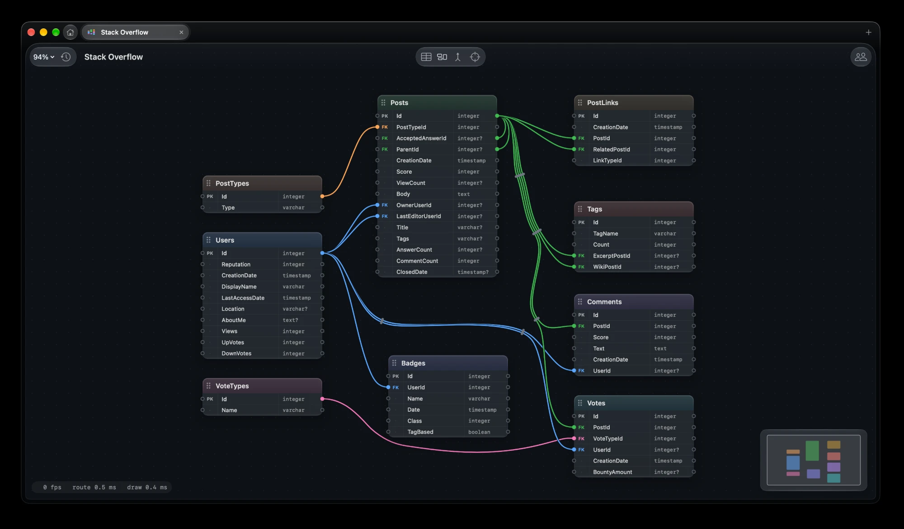

# Joinery

Joinery is a macOS app for sketching SQL data models on an infinite canvas. Tables sit on the canvas, foreign keys are
drawn as wires between column sockets, and wires can be zip-tied into bundles. Models live in a Freeform-style library
with version history, can be edited live with others through an end-to-end encrypted relay, and can be read and changed
by AI assistants over MCP. It needs macOS 26 and Xcode 26: open `Joinery.xcodeproj` and press ⌘R. The full guide is in
[docs/guide.md](docs/guide.md), and building and releasing it in [docs/development.md](docs/development.md).

The relay in [relay/](relay/) is a small Zig server that passes live sessions between people without reading them. A
2-core host with 2 GB holds 13,000 rooms of four at typical use (52,000 people) with presence over UDP, or 5,500 by
WebSocket alone; CPU runs out first, not memory. Flat out, it delivers 1.5 million messages a second on 2 cores and 5.4
million on 16. It ships as the container `ghcr.io/mtsaas/joinery-relay` and the Helm chart
`oci://ghcr.io/mtsaas/charts/joinery-relay`.
